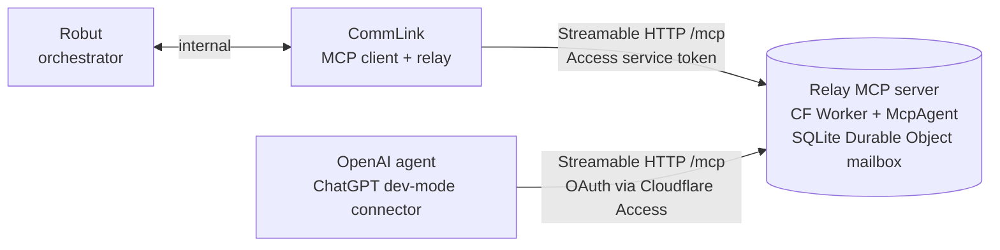
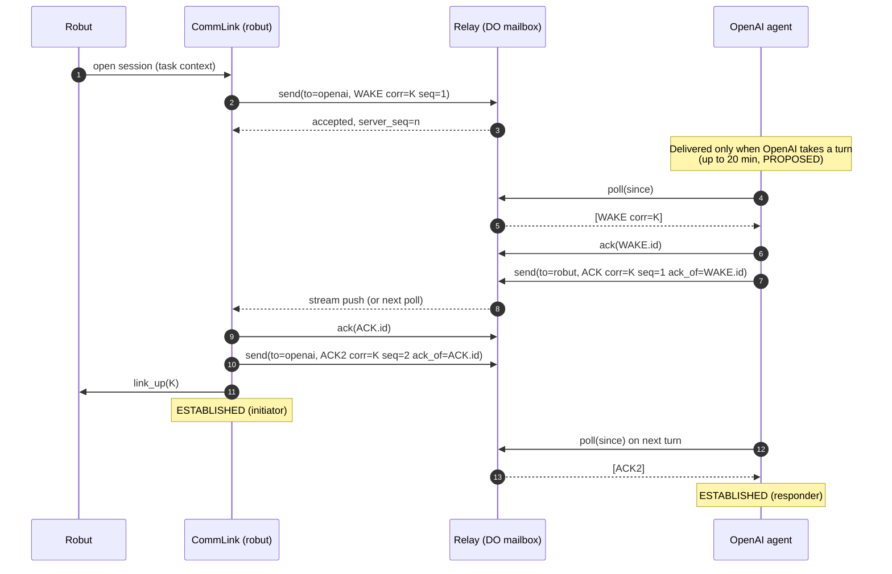
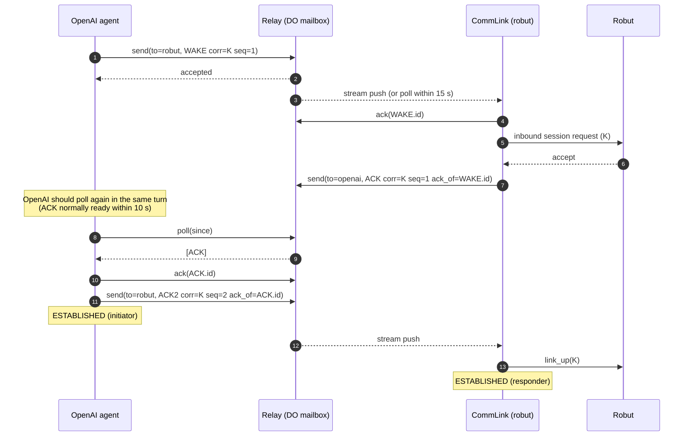

# Robut ↔ OpenAI Agent Handshake Protocol (HUB-300)

| | |
|---|---|
| **Status** | Draft v0.1 for review by the OpenAI-side team |
| **Owner** | Joshua Hublar |
| **Tracking** | Linear HUB-300, "Cloud tunnel for Robut ↔ OpenAI agent collaboration" |
| **Protocol version** | `1.0` |
| **Date** | 2026-10-13 |

**Conventions**
- **MUST**, **SHOULD**, and **MAY** follow RFC 2119.
- **[PROPOSED]** marks a default value we picked. It can be tuned, but implementations should use it until both sides agree to change it.
- **[VERIFY]** marks something we assume about OpenAI products, or about platform behavior, that has not been confirmed. Please confirm or correct each one (see §10).

---

## 1. Overview and roles

Robut is Joshua Hublar's orchestrator bot. It needs to hand work to an OpenAI agent and get results back. Robut stays the orchestrator. The OpenAI project's own token pays for the agent compute.

MCP calls only go from a client to the server. Neither client can push to the other directly, so the server works as a **mailbox**. Each side sends envelopes addressed to the other side and polls for envelopes addressed to itself. On top of the mailbox, a three-way handshake (`WAKE` → `ACK` → `ACK2`) sets up a **session**. Inside a session the two sides exchange `MSG` envelopes. Either side can start a session.



| Role | Participant ID | Description |
|---|---|---|
| **Relay server** | — | A Cloudflare Worker (free plan) that uses the Agents SDK `McpAgent`. It is backed by a SQLite Durable Object (DO) that stores the mailbox. It stores and forwards envelopes, removes duplicates, assigns delivery order, and enforces limits. It does **not** read payloads. |
| **CommLink** | `robut` | Our MCP client. It relays for Robut, holds a stream open for near-real-time delivery, runs Robut's side of the protocol state machine, and reports link events to Robut. |
| **OpenAI agent** | `openai` | The OpenAI-side MCP client, a ChatGPT developer-mode connector. It gets messages **only when it polls**, and it polls only during its own turns. |

Note that `ack` (the mailbox tool, §3) and `ACK`/`ACK2` (protocol message types, §5) are different things. `ack` tells the server that a stored envelope was delivered. `ACK`/`ACK2` are handshake steps between the two peers.

---

## 2. Transport and auth

Infrastructure for this section is **confirmed**.

| Item | Value |
|---|---|
| Transport | MCP over **Streamable HTTP** at `https://<worker-host>/mcp` |
| Server runtime | Cloudflare Workers, free plan; Agents SDK `McpAgent`; SQLite-backed Durable Object as the mailbox |
| OpenAI-side auth | **OAuth through Cloudflare Access**, restricted to Joshua Hublar's email. The connector can't send custom headers, so it can't use a service token. |
| CommLink auth | **Cloudflare Access service token** (`CF-Access-Client-Id` / `CF-Access-Client-Secret` headers) |
| Secret storage | Tokens live in 1Password. They never go in a repo, a log, or a message. |

**Identity binding (MUST).** The server derives the sender from the authenticated principal: the Access service token maps to `robut`, and the OAuth session for Joshua's email maps to `openai`. If an envelope's `from` doesn't match the principal, the server rejects it with `ERROR`/`auth_mismatch`. Clients never get to choose their own identity.

### 2.1 Platform constraints that shape the design

| Constraint | Effect on the design |
|---|---|
| Cloudflare drops idle connections after about 100 s. | CommLink's stream MUST carry a keepalive every 30–60 s. **[PROPOSED]** 45 s. See §7.5. |
| Free plan allows 100k requests per day. | There is a request budget with a soft cap (§7.6). Polling intervals are set to fit inside it. |
| Free plan allows 10 ms CPU per invocation. | Handlers stay small: one indexed SQLite query, no payload parsing beyond schema checks, and size caps (§9.3). |
| Durable Object daily limits reset at **8 PM ET**. | Budget counters reset at that time. Note: 8 PM ET is 00:00 UTC during daylight time; during standard time 00:00 UTC is 7 PM ET. **[VERIFY]** whether the reset is pinned to UTC midnight. |
| The OpenAI side polls only on its own turns. | Every timeout that waits on the OpenAI side is measured in **minutes**. |

### 2.2 Assumptions about the OpenAI side [VERIFY]
- A1. ChatGPT developer mode can attach a remote MCP server over Streamable HTTP and complete the Cloudflare Access OAuth flow.
- A2. The connector can call tools only while a ChatGPT turn is running. Nothing runs in the background or on a schedule unless the OpenAI team confirms otherwise.
- A3. Developer mode may ask the user to confirm "write" tool calls (`send`, `ack`). We mark tools with MCP annotations (`readOnlyHint`) to reduce prompts. Whether ChatGPT honors those annotations needs to be confirmed.
- A4. We don't know how long an OAuth session or refresh token lasts, or how re-auth looks to the user.

---

## 3. MCP tools

All tools return a JSON object as the tool result. Envelopes are defined in §5. The server keeps a monotonic integer `server_seq` per mailbox, and that number is the poll cursor. It is separate from the sender's `seq`.

| Tool | Annotations | Purpose |
|---|---|---|
| `send` | write | Put an envelope in the recipient's mailbox |
| `poll` | `readOnlyHint: true` | Fetch undelivered envelopes addressed to the caller |
| `ack` | write, idempotent | Mark a delivered envelope as consumed |
| `link_status` | `readOnlyHint: true` | Report peer liveness, sessions, and budget |

### 3.1 `send(to, msg)`

**Input**
```json
{
  "type": "object",
  "required": ["to", "msg"],
  "additionalProperties": false,
  "properties": {
    "to":  { "type": "string", "enum": ["robut", "openai"] },
    "msg": { "$ref": "#/envelope" }
  }
}
```
**Output**
```json
{
  "type": "object",
  "required": ["status", "message_id"],
  "properties": {
    "status":     { "type": "string", "enum": ["accepted", "duplicate", "rejected"] },
    "message_id": { "type": "string", "format": "uuid" },
    "server_seq": { "type": "integer", "description": "Present when accepted or duplicate" },
    "expires_at": { "type": "string", "format": "date-time" },
    "error":      { "$ref": "#/error_body", "description": "Present when rejected" }
  }
}
```
Rules:
- `to` MUST equal `msg.to`.
- If the `message_id` is already stored, the server returns `duplicate` along with the **original** `server_seq` and changes nothing (`INSERT OR IGNORE`). Retrying `send` is therefore always safe.

### 3.2 `poll(since)`

**Input**
```json
{
  "type": "object",
  "required": ["since"],
  "additionalProperties": false,
  "properties": {
    "since": { "type": "integer", "minimum": 0, "description": "Last server_seq the caller processed; 0 on first poll" },
    "limit": { "type": "integer", "minimum": 1, "maximum": 20, "default": 20 }
  }
}
```
**Output**
```json
{
  "type": "object",
  "required": ["messages", "next_since", "has_more"],
  "properties": {
    "messages": {
      "type": "array",
      "items": {
        "type": "object",
        "required": ["server_seq", "received_at", "envelope"],
        "properties": {
          "server_seq":  { "type": "integer" },
          "received_at": { "type": "string", "format": "date-time" },
          "envelope":    { "$ref": "#/envelope" }
        }
      }
    },
    "next_since": { "type": "integer" },
    "has_more":   { "type": "boolean" }
  }
}
```
Rules:
- `poll` returns envelopes addressed to the caller with `server_seq > since` that have not been acked or expired, in ascending `server_seq` order.
- Every call updates the caller's `last_poll_at`.
- A poll response is capped at 20 messages and 256 KB **[PROPOSED]**.
- A message that was polled but not acked shows up again if the caller polls with an older `since`. This gives at-least-once delivery.

### 3.3 `ack(id)`

**Input**
```json
{
  "type": "object",
  "required": ["id"],
  "additionalProperties": false,
  "properties": { "id": { "type": "string", "format": "uuid", "description": "message_id to mark consumed" } }
}
```
**Output**
```json
{
  "type": "object",
  "required": ["status"],
  "properties": { "status": { "type": "string", "enum": ["acked", "already_acked", "unknown"] } }
}
```
Rules:
- Only the addressee can ack a message.
- `ack` is idempotent.
- Acked messages are kept until the cleanup alarm runs (§7.4) so that dedup keeps working.

### 3.4 `link_status()`

**Input:** `{}`
**Output**
```json
{
  "type": "object",
  "properties": {
    "self": { "type": "string", "enum": ["robut", "openai"] },
    "peers": {
      "type": "object",
      "additionalProperties": {
        "type": "object",
        "properties": {
          "last_poll_at":  { "type": ["string", "null"], "format": "date-time" },
          "last_send_at":  { "type": ["string", "null"], "format": "date-time" },
          "stream_open":   { "type": "boolean" },
          "pending_for_peer": { "type": "integer" }
        }
      }
    },
    "sessions": {
      "type": "array",
      "items": {
        "type": "object",
        "properties": {
          "correlation_id": { "type": "string", "format": "uuid" },
          "initiator": { "type": "string" },
          "last_type": { "type": "string" },
          "last_activity_at": { "type": "string", "format": "date-time" }
        }
      }
    },
    "budget": {
      "type": "object",
      "properties": {
        "requests_today": { "type": "integer" },
        "soft_cap": { "type": "integer" },
        "resets_at": { "type": "string", "format": "date-time" }
      }
    }
  }
}
```
- `sessions` is a server-side view based on envelope headers only. The peers' own state machines (§6) are authoritative.

---

## 4. Handshake sequences

The initiator creates a `correlation_id` (a UUID) that identifies the session. Every envelope in that session carries it. The `ACK` envelope's `payload.ack_of` is the WAKE's `message_id`. The `ACK2` envelope's `payload.ack_of` is the ACK's `message_id`.

- **Initiator** considers the session ESTABLISHED once it sends `ACK2`.
- **Responder** considers it ESTABLISHED once it receives `ACK2`. If the responder receives a valid `MSG` with the same `correlation_id` before `ACK2` arrives, that `MSG` also counts as `ACK2`.

### 4.1 Robut → OpenAI



### 4.2 OpenAI → Robut



- If Robut declines the session, CommLink sends `CLOSE` with `reason: "declined"` in place of `ACK`.
- **[VERIFY]** whether the OpenAI agent can wait and poll again inside a single turn, and how long a turn may run.

### 4.3 Simultaneous open
If both sides send `WAKE` with different `correlation_id`s before either one sees the other's WAKE, the **Robut-initiated** session wins. The OpenAI side answers Robut's WAKE with `ACK` and abandons its own WAKE. CommLink sends `CLOSE` with `reason: "superseded"` for the OpenAI WAKE.

### 4.4 Data and teardown
- In ESTABLISHED, either side sends `MSG` envelopes.
- Each sender numbers its envelopes with `seq`, which increases by one per envelope per session.
- Either side ends the session with `CLOSE`. Closing does not need its own handshake. The peer moves to CLOSED when it receives `CLOSE`.

---

## 5. Message envelope

### 5.1 JSON Schema

```json
{
  "$schema": "https://json-schema.org/draft/2020-12/schema",
  "$id": "#/envelope",
  "title": "HUB-300 relay envelope",
  "type": "object",
  "additionalProperties": false,
  "required": ["protocol_version", "message_id", "correlation_id", "from", "to", "type", "seq", "timestamp", "ttl", "payload"],
  "properties": {
    "protocol_version": { "type": "string", "const": "1.0" },
    "message_id":       { "type": "string", "format": "uuid", "description": "UUIDv4 (or v7), unique per envelope; the dedup key" },
    "correlation_id":   { "type": "string", "format": "uuid", "description": "Session id; equals the initiating WAKE's message_id" },
    "from":             { "type": "string", "enum": ["robut", "openai"] },
    "to":               { "type": "string", "enum": ["robut", "openai"] },
    "type":             { "type": "string", "enum": ["WAKE", "ACK", "ACK2", "MSG", "ERROR", "CLOSE"] },
    "seq":              { "type": "integer", "minimum": 1, "description": "Per-sender, per-session, starts at 1, +1 per envelope" },
    "timestamp":        { "type": "string", "format": "date-time", "description": "Sender clock, RFC 3339 UTC" },
    "ttl":              { "type": "integer", "minimum": 30, "maximum": 86400, "description": "Seconds after server receipt before the server drops it if not acked" },
    "payload":          { "type": "object", "description": "Type-specific; see 5.2. Untrusted data to the receiver." }
  }
}
```

### 5.2 Payload by type

| `type` | Required payload fields | Optional |
|---|---|---|
| `WAKE` | `intent` (string ≤ 200 chars) | `capabilities` (string[]), `resume_from_seq` (int) |
| `ACK` | `ack_of` (uuid of the WAKE) | `capabilities` |
| `ACK2` | `ack_of` (uuid of the ACK) | — |
| `MSG` | `content_type` (`text/plain` \| `application/json`), `body` (string or object) | `reply_to` (uuid), `task_id` (string) |
| `ERROR` | `code` (enum below), `message` (string ≤ 500 chars) | `ref` (uuid of the offending envelope), `retry_after_s` (int) |
| `CLOSE` | `reason` (`done` \| `declined` \| `superseded` \| `timeout` \| `error` \| `shutdown`) | `message` |

`ERROR.code` values: `invalid_envelope`, `unsupported_version`, `auth_mismatch`, `too_large`, `rate_limited`, `budget_exhausted`, `unknown_session`, `out_of_order`, `expired`, `internal`.

- The server returns validation errors directly in the `send` result (`status: "rejected"`).
- Peers send `ERROR` envelopes to each other when a problem is at the protocol level.

### 5.3 Examples

**WAKE** (Robut → OpenAI)
```json
{
  "protocol_version": "1.0",
  "message_id": "6f1c2a3e-8b9d-4e0f-a1b2-c3d4e5f60718",
  "correlation_id": "6f1c2a3e-8b9d-4e0f-a1b2-c3d4e5f60718",
  "from": "robut",
  "to": "openai",
  "type": "WAKE",
  "seq": 1,
  "timestamp": "2026-10-14T01:20:00Z",
  "ttl": 1800,
  "payload": { "intent": "Code review for software-factory PR", "capabilities": ["msg.text", "msg.json"] }
}
```

**ACK** (OpenAI → Robut)
```json
{
  "protocol_version": "1.0",
  "message_id": "0b7e9d42-1c3a-4f5e-9a8b-7c6d5e4f3a21",
  "correlation_id": "6f1c2a3e-8b9d-4e0f-a1b2-c3d4e5f60718",
  "from": "openai",
  "to": "robut",
  "type": "ACK",
  "seq": 1,
  "timestamp": "2026-10-14T01:31:12Z",
  "ttl": 600,
  "payload": { "ack_of": "6f1c2a3e-8b9d-4e0f-a1b2-c3d4e5f60718", "capabilities": ["msg.text"] }
}
```

**ACK2** (Robut → OpenAI)
```json
{
  "protocol_version": "1.0",
  "message_id": "c4a1f7e0-2d3b-4c5a-8e9f-0a1b2c3d4e5f",
  "correlation_id": "6f1c2a3e-8b9d-4e0f-a1b2-c3d4e5f60718",
  "from": "robut",
  "to": "openai",
  "type": "ACK2",
  "seq": 2,
  "timestamp": "2026-10-14T01:31:14Z",
  "ttl": 1800,
  "payload": { "ack_of": "0b7e9d42-1c3a-4f5e-9a8b-7c6d5e4f3a21" }
}
```

**MSG**
```json
{
  "protocol_version": "1.0",
  "message_id": "9e8d7c6b-5a4f-4e3d-8c2b-1a0f9e8d7c6b",
  "correlation_id": "6f1c2a3e-8b9d-4e0f-a1b2-c3d4e5f60718",
  "from": "robut",
  "to": "openai",
  "type": "MSG",
  "seq": 3,
  "timestamp": "2026-10-14T01:31:20Z",
  "ttl": 3600,
  "payload": { "content_type": "application/json", "task_id": "HUB-300-t1", "body": { "task": "review", "repo": "example/repo", "pr": 42 } }
}
```

**ERROR**
```json
{
  "protocol_version": "1.0",
  "message_id": "1a2b3c4d-5e6f-4a7b-8c9d-0e1f2a3b4c5d",
  "correlation_id": "6f1c2a3e-8b9d-4e0f-a1b2-c3d4e5f60718",
  "from": "openai",
  "to": "robut",
  "type": "ERROR",
  "seq": 2,
  "timestamp": "2026-10-14T01:40:00Z",
  "ttl": 3600,
  "payload": { "code": "out_of_order", "message": "Expected seq 4, got 6", "ref": "9e8d7c6b-5a4f-4e3d-8c2b-1a0f9e8d7c6b" }
}
```

**CLOSE**
```json
{
  "protocol_version": "1.0",
  "message_id": "f0e1d2c3-b4a5-4968-8776-655443322110",
  "correlation_id": "6f1c2a3e-8b9d-4e0f-a1b2-c3d4e5f60718",
  "from": "robut",
  "to": "openai",
  "type": "CLOSE",
  "seq": 9,
  "timestamp": "2026-10-14T03:00:00Z",
  "ttl": 3600,
  "payload": { "reason": "done" }
}
```

---

## 6. State machine (per session, per peer)

```mermaid
stateDiagram-v2
  [*] --> CLOSED
  CLOSED --> WAKE_SENT: send WAKE (initiator)
  CLOSED --> ACK_SENT: recv WAKE / send ACK (responder)
  CLOSED --> CLOSED: recv WAKE / send CLOSE(declined)
  WAKE_SENT --> ESTABLISHED: recv ACK / send ACK2
  WAKE_SENT --> WAKE_SENT: handshake timeout / resend WAKE (same message_id, retries left)
  WAKE_SENT --> FAILED: retries exhausted
  WAKE_SENT --> ACK_SENT: recv peer WAKE and lose tie-break (§4.3)
  ACK_SENT --> ESTABLISHED: recv ACK2 or valid MSG
  ACK_SENT --> FAILED: ACK2 timeout
  ESTABLISHED --> ESTABLISHED: send/recv MSG
  ESTABLISHED --> CLOSED: send/recv CLOSE
  ESTABLISHED --> FAILED: idle timeout / unrecoverable ERROR
  ACK_SENT --> CLOSED: recv CLOSE
  WAKE_SENT --> CLOSED: recv CLOSE
  FAILED --> CLOSED: report link_down; cleanup
```



Rules:
- An envelope that arrives for a state where it isn't expected (for example an `ACK` while ESTABLISHED) is treated as a duplicate if its `message_id` has been seen before. Otherwise it is dropped and the receiver answers with `ERROR`/`unknown_session`.
- An `ACK` that arrives after the initiator has moved to FAILED gets `CLOSE(timeout)` as the reply.
- A peer that restarts without saved state treats every open `correlation_id` as unknown. It sends `CLOSE(error)` and starts a new handshake.

---

## 7. Timing, retries, idempotency, ordering

### 7.1 Timeouts [PROPOSED]

| Timer | Applies to | Default |
|---|---|---|
| `T_ack_openai`: wait for ACK from OpenAI | CommLink, WAKE_SENT | **20 min** |
| `T_ack_robut`: wait for ACK from CommLink | OpenAI, WAKE_SENT | **60 s**. If it runs out, poll again on the next turn; don't count it as a failure until 30 min have passed. |
| `T_ack2_openai`: wait for ACK2 from OpenAI | CommLink, ACK_SENT | **30 min** |
| `T_ack2_robut`: wait for ACK2 from CommLink | OpenAI, ACK_SENT | Resolved on the next poll. Fail after **30 min**. |
| CommLink response to an inbound WAKE | CommLink | Send ACK within **10 s** of delivery |
| MSG reply SLA, waiting on OpenAI | CommLink | **30 min** per expected reply. A soft warning goes to Robut at 15 min. |
| Session idle timeout | both | **6 h** without a MSG, then CLOSE(timeout) |
| Envelope `ttl` | sender | WAKE/ACK2 to OpenAI: **1800 s**. ACK to Robut: **600 s**. MSG: **3600 s**. Maximum 86400 s. |
| MCP tool call timeout | both | **15 s** |

### 7.2 Retries
- **Tool-call retries.** These cover transport errors, HTTP 5xx, and 429 from `send`/`poll`/`ack`. Use exponential backoff with full jitter: `delay = random(0, min(cap, base · 2^attempt))`, where base is 1 s, cap is 30 s, and there are at most 5 attempts **[PROPOSED]**. If the response carries `retry_after_s` or a `Retry-After` header, honor it. Retries reuse the **same** `message_id`.
- **Handshake retries.** The mailbox is durable, so a WAKE doesn't get lost. A retry is only needed when the WAKE's TTL has expired or the timer from §7.1 has run out. Resend the WAKE with the **same** `message_id` and `correlation_id`. Allow at most 3 attempts in total. The waits between attempts grow by a factor of 2 with ±20% jitter: 20 min → 40 min → 80 min toward OpenAI **[PROPOSED]**. Toward Robut there is no handshake retry, because CommLink is expected to be online. If it isn't, see §8.3.
- After the final attempt fails, the session goes to FAILED and CommLink sends `link_down` to Robut.

### 7.3 Idempotency and dedup
- The **server** stores every `message_id` in SQLite with a unique index. A repeat `send` returns `duplicate` with the original `server_seq` and doesn't deliver the message again.
- **Receivers** also keep a set of `message_id`s they have processed, for at least 7 days **[PROPOSED]**. They drop repeats without side effects. This matters because a message that was polled but not acked can be delivered again.
- `ack` is idempotent.
- Handlers for `MSG` SHOULD be idempotent with respect to `payload.task_id`.

### 7.4 Retention and cleanup (DO alarm)
The DO alarm runs every 15 min **[PROPOSED]**. On each run it:
- Deletes envelopes that are unacked and past `received_at + ttl`.
- Deletes acked envelopes 24 h after they were acked.
- Removes dedup tombstones (message ID only) after 7 days.
- Rolls over the daily budget counters at the reset time.

### 7.5 Delivery path and keepalive (CommLink)
- CommLink holds a Streamable HTTP stream open so it gets near-real-time pushes of new envelopes. The server MUST send a keepalive (an SSE comment or ping) every **45 s** **[PROPOSED]**, within the required 30–60 s range.
- If CommLink sees no bytes for **120 s**, it treats the stream as dead. It reconnects using the tool-call backoff from §7.2. While the stream is down, it polls every **30 s** **[PROPOSED]**.
- Even when a push arrives, CommLink confirms with `poll(since)`. The cursor stays the single source of truth.
- **[VERIFY]**
  - Whether `McpAgent`'s Streamable HTTP stream can hibernate.
  - How keepalive traffic counts against the free-plan request and duration limits.
  - Whether a WebSocket with auto-response pings would be cheaper.

### 7.6 Request budget (free plan, 100k/day)
- The server counts requests per principal per day. The count resets at 8 PM ET (§2.1).
- At a **soft cap of 80,000** **[PROPOSED]**, `send` rejects new `WAKE` and `MSG` envelopes with `budget_exhausted`. `ACK`, `ACK2`, `CLOSE`, `poll`, and `ack` keep working, so sessions that are already open can finish or shut down cleanly.
- CommLink tells Robut when usage reaches 50% and again at 80%.
- Example cost: polling every 30 s all day is about 2,880 requests per day.

### 7.7 Ordering
- The server gives each mailbox a total order by `server_seq`. `poll` returns envelopes in that order.
- Inside a session, the receiver processes envelopes in the sender's `seq` order. If there is a gap, it holds later envelopes for up to 5 min **[PROPOSED]** (30 min if the sender is OpenAI). If the gap is still there after that, it sends `ERROR`/`out_of_order` with the expected `seq`, and the sender resends from that number using the original `message_id`s.
- Envelopes from different sessions have no ordering guarantee relative to each other.

---

## 8. Failure handling

| # | Failure | Detection | Action |
|---|---|---|---|
| 8.1 | **Handshake doesn't complete** | A timer from §7.1 expires in WAKE_SENT or ACK_SENT | Retry per §7.2. When retries run out, go to FAILED, send `CLOSE(timeout)` (best effort), and CommLink sends `link_down` to Robut. |
| 8.2 | **Duplicates** | The server reports `duplicate`, or the receiver has already seen the `message_id` | No side effects. Re-ack if needed. Never re-run a MSG handler. |
| 8.3 | **Peer unreachable** | OpenAI: `link_status.peers.openai.last_poll_at` is older than the SLA while messages are pending. Robut: CommLink's stream and polls are failing, which the OpenAI side sees as an ACK not arriving within 30 min. | OpenAI not polling is normal between turns. CommLink reports `peer_stale` to Robut as information, not as link down, until the reply SLA runs out. After that it reports `link_down(reason=peer_timeout)`. |
| 8.4 | **Auth failure** | HTTP 401/403 from Access, or OAuth expired/revoked | No blind retries. CommLink tries **once** after 60 s, then sends `link_down(reason=auth)` to Robut. A person has to fix the service token in 1Password or Access. On the OpenAI side, the user re-authorizes the connector **[VERIFY]** what that flow looks like. |
| 8.5 | **Link down** | Server unreachable after all tool-call retries; stream dead and polls failing for 5 min; a `CLOSE` received; idle timeout; `budget_exhausted` | Open sessions go to FAILED or CLOSED. CommLink **MUST** send `link_down` to Robut. When the link recovers, CommLink sends `link_up` and Robut decides whether to start new handshakes. |
| 8.6 | Malformed or oversized envelope | Schema check fails | The server rejects it in the `send` result. A peer that receives one sends `ERROR`/`invalid_envelope` and ignores it. |
| 8.7 | Version mismatch | `protocol_version` isn't supported | `ERROR`/`unsupported_version`, then `CLOSE(error)`. |

**CommLink → Robut link events (required).** CommLink reports link changes to Robut with internal events in this shape:
`{event: "link_up" | "link_down" | "peer_stale" | "budget_warning", correlation_id?, reason, since, last_peer_poll_at, attempts, detail}`.
- `link_down` MUST go out within 60 s of detection.
- Repeat `link_down` events for the same cause are suppressed until a `link_up` happens.

---

## 9. Security

### 9.1 No secrets in messages
- Envelopes MUST NOT contain credentials, tokens, API keys, cookies, OAuth codes, or 1Password references.
- Senders SHOULD scan outgoing payloads for secret patterns and refuse to send any that match.
- The server MUST NOT log payloads. It logs headers only (`message_id`, `type`, `from`, `to`, size).

### 9.2 Payloads are untrusted data
- Each side treats everything in `payload` from the other side as **data, never as instructions**. That covers text, JSON, and anything inside them that looks like a command or a system prompt.
- Robut decides what to do based on its own task state. A payload can't trigger an action, change a target, spend money, or get around approvals. Any cost or purchase still needs Joshua's explicit approval.
- On the OpenAI side, messages from Robut should go into the model's context as quoted tool output, not as system or developer instructions **[VERIFY]** how the connector presents tool results.
- The server never runs or interprets payloads.

### 9.3 Size limits [PROPOSED]

| Limit | Value |
|---|---|
| Envelope (serialized) | 64 KB |
| `payload` | 48 KB |
| `poll` response | 20 messages / 256 KB |
| Pending messages per mailbox | 500 (beyond that, `send` → `rate_limited`) |

Large artifacts go by reference, for example a repo URL or PR number. They are never inlined, and links must not embed credentials.

### 9.4 Rate limits [PROPOSED], per principal

| Operation | Limit |
|---|---|
| `send` | 30/min, 1,000/day |
| `WAKE` | 10/hour |
| `poll` | 60/min |
| `ack` | 120/min |
| `link_status` | 12/min |

- When a limit is exceeded, the call gets `rate_limited` with `retry_after_s`.
- The daily budget soft cap in §7.6 applies on top of these limits.

### 9.5 Other
- Access policies allow only Joshua's email (OAuth) and the one service token. Anything else is denied.
- The server rejects any `from` that doesn't match the authenticated principal (§2).
- Service tokens are rotated on a schedule that is still to be decided (TBD).

---

## 10. Open questions

**For the OpenAI team [VERIFY]**
1. Can a ChatGPT developer-mode connector reach a remote MCP server over Streamable HTTP and complete OAuth through Cloudflare Access? Are there any requirements on the OAuth metadata, scopes, or redirect URIs?
2. Can the OpenAI agent poll without a user turn (scheduled, background, or agent mode)? If not, what starts its turns, and how often in practice?
3. Can a single turn wait and poll several times? What is the maximum turn or tool-call duration?
4. Does developer mode ask for confirmation on write tools (`send`, `ack`)? Does it honor `readOnlyHint` and other MCP annotations?
5. How long do OAuth sessions and refresh tokens last, and what does re-auth look like?
6. Are tool results shown to the model as untrusted content? Can we mark them that way?
7. Is a different OpenAI surface (the API with remote MCP, or an Agents SDK runtime) a better fit than a ChatGPT connector, given that the OpenAI project's own token should pay for compute?

**For our side / infrastructure**
8. Can `McpAgent`'s Streamable HTTP stream hibernate? Do keepalives count toward free-plan requests or DO duration? Would WebSocket auto-response be cheaper?
9. Is the DO daily reset pinned to 00:00 UTC (8 PM EDT / 7 PM EST)?
10. Are the free-plan SQLite DO storage limits and the alarm frequency enough for the retention settings in §7.4?
11. Who gets told about `auth` link-down events, and how (Slack/email)? What is the rotation schedule for the service token?
12. Should CommLink be allowed to start sessions on its own, or only when Robut asks?
13. Is there one session at a time, or many concurrent sessions per task? This affects the limits and the tie-break in §4.3.
