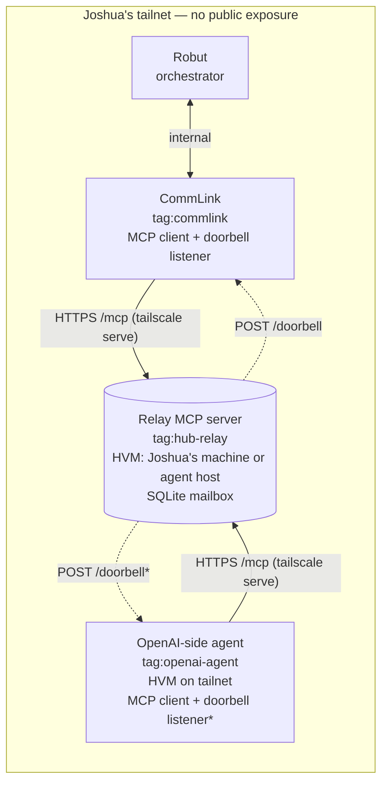
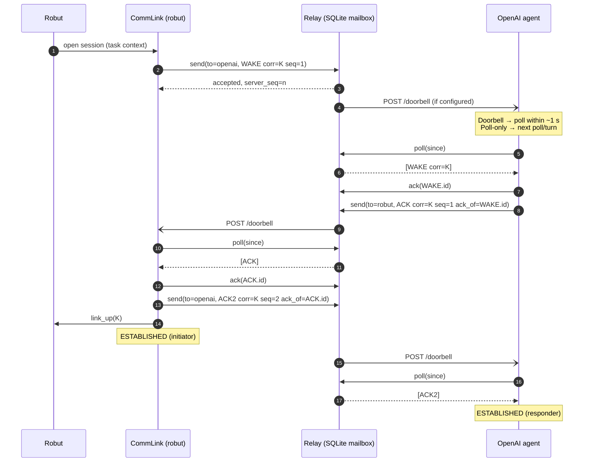
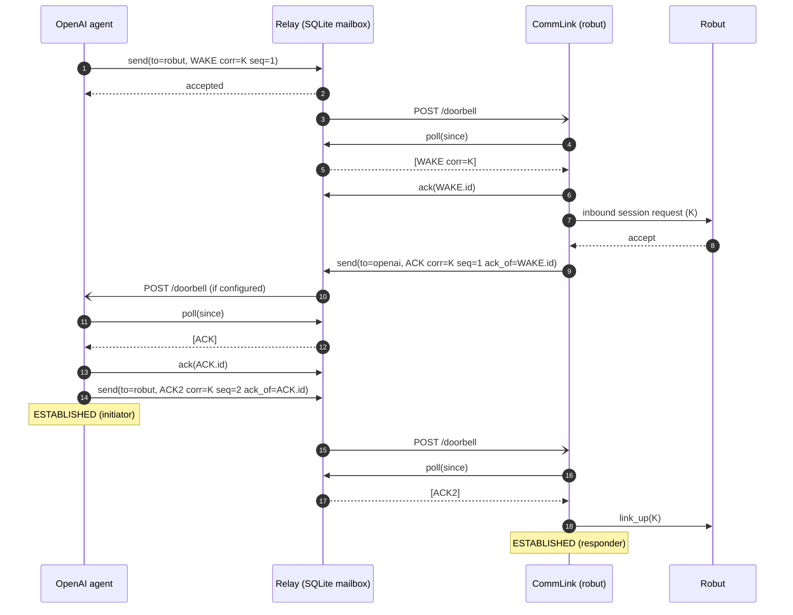

# Robut ↔ OpenAI Agent Handshake Protocol (HUB-300)

| | |
|---|---|
| **Status** | Draft v0.2 for review by the OpenAI-side team |
| **Owner** | Joshua Hublar |
| **Tracking** | Linear HUB-300, "Cloud tunnel for Robut ↔ OpenAI agent collaboration" |
| **Protocol version** | `1.0` (wire format unchanged from v0.1) |
| **Date** | 2026-10-13 |
| **Supersedes** | v0.1, the Cloudflare Workers + Access design (`agent-handshake-protocol.cloudflare-v1.md`) |

**Conventions**
- **MUST**, **SHOULD**, and **MAY** follow RFC 2119.
- **[PROPOSED]** marks a default we picked. It can be tuned, but implementations should use it until both sides agree to change it.
- **[VERIFY]** marks something we assume about OpenAI or Tailscale product behavior that has not been confirmed (see §11).

**What changed from v0.1**
- Cloudflare is gone: no Worker, Durable Object, Tunnel, or Access, and no public endpoint or webhook.
- The relay now runs on an HVM inside Joshua's Tailscale tailnet, with mailbox storage in local SQLite.
- Auth is tailnet identity (ACLs/grants, tags, WhoIs), with an optional bearer token.
- A new tailnet-to-tailnet **doorbell** delivers wake-ups, and polling stays as the fallback.
- There are now two timing profiles. The free-plan quotas and budget soft cap are replaced by local rate limits.
- §9 on tailnet failure modes is new.
- The handshake and the envelope are unchanged.

---

## 1. Overview and roles

Robut is Joshua Hublar's orchestrator bot. It needs to hand work to an OpenAI agent and get results back. Robut stays the orchestrator. The OpenAI project's own token pays for the agent compute.

MCP calls only go from a client to the server. Neither client can push to the other directly, so the server works as a **mailbox**. Each side sends envelopes addressed to the other side and polls for envelopes addressed to itself.

To avoid waiting on polls, the server rings a **doorbell**: it sends a small HTTP POST to a listener on the recipient's tailnet address. The doorbell only says "you have mail" and never carries message content. On top of the mailbox, a three-way handshake (`WAKE` → `ACK` → `ACK2`) sets up a **session**. Either side can start a session.


\* The OpenAI-side listener is optional. Without it, that side runs the poll-only profile (§7.1).

| Role | Participant ID | Tailscale tag [PROPOSED] | Description |
|---|---|---|---|
| **Relay server** | — | `tag:hub-relay` | An MCP server on an HVM in the tailnet, either Joshua's machine or the agent host. It stores and forwards envelopes in local SQLite, removes duplicates, assigns delivery order, rings doorbells, and enforces limits. It does **not** read payloads. |
| **CommLink** | `robut` | `tag:commlink` | Our MCP client. It relays for Robut, runs a doorbell listener, runs Robut's side of the state machine, and reports link events to Robut. |
| **OpenAI-side agent** | `openai` | `tag:openai-agent` | An OpenAI agent running on an HVM joined to the tailnet. It acts as an MCP client and may also run a doorbell listener. **[VERIFY]** Which OpenAI runtime this is, and whether its MCP client supports Streamable HTTP to a private tailnet address. A ChatGPT connector hosted in OpenAI's cloud can't reach a private tailnet, so the agent has to run on the HVM. |

`ack` (the mailbox tool, §3) and `ACK`/`ACK2` (protocol message types, §5) are different things:
- `ack` tells the server that a stored envelope was consumed.
- `ACK`/`ACK2` are handshake steps between the two peers.

---

## 2. Transport and auth

### 2.1 Transport
| Item | Value |
|---|---|
| MCP transport | **Streamable HTTP** at `/mcp` |
| Address | Only a tailnet address or a MagicDNS name, e.g. `https://hub-relay.<tailnet>.ts.net/mcp` |
| TLS | **SHOULD** use HTTPS through `tailscale serve`, which proxies to the MCP server on `127.0.0.1`. Plain HTTP to the tailnet IP is acceptable, since WireGuard already encrypts the traffic, but it is less preferred. |
| Exposure | **MUST NOT** use Tailscale Funnel, port forwarding, or any public listener. Services bind to `127.0.0.1` behind serve, or to the tailnet interface only. Never `0.0.0.0`. |
| Doorbell | The server sends `POST https://<peer-magicdns>/doorbell` (or `http://<peer-tailnet-ip>:8787/doorbell` **[PROPOSED]**) |
| Storage | SQLite on the relay host in WAL mode. The DB file is mode `0600` and owned by the relay service user. |

Note: certificates issued for `tailscale serve` HTTPS show up in public Certificate Transparency logs, so the MagicDNS hostname becomes publicly visible. The service is still not reachable from outside. Pick hostnames that don't reveal anything sensitive **[VERIFY]** against current Tailscale docs.

### 2.2 Auth: tailnet identity first
1. **Network layer (MUST).** Tailscale ACLs/grants allow only these flows. All other traffic is denied by default.
   ```jsonc
   // [PROPOSED] policy fragment (illustrative syntax; [VERIFY] against current grants schema)
   "tagOwners": { "tag:hub-relay": ["autogroup:admin"], "tag:commlink": ["autogroup:admin"], "tag:openai-agent": ["autogroup:admin"] },
   "grants": [
     { "src": ["tag:commlink", "tag:openai-agent"], "dst": ["tag:hub-relay"], "ip": ["tcp:443"] },
     { "src": ["tag:hub-relay"], "dst": ["tag:commlink", "tag:openai-agent"], "ip": ["tcp:8787"] }
   ]
   ```
   Peers have **no** direct grant to each other. All traffic between them goes through the relay.
2. **Sender identity (MUST).** The server works out the caller's identity and sets `from` from it. Clients never choose their own identity. Two ways to do this:
   - **(a) Preferred:** run the MCP server embedded with `tsnet`, or call the local `tailscaled` WhoIs API on the connection's true source address. Map the node's tag to a participant (`tag:commlink` → `robut`, `tag:openai-agent` → `openai`).
   - **(b) Behind `tailscale serve`:** use the identity headers that serve adds. **[VERIFY]** Serve's `Tailscale-User-*` headers appear to identify *user*-owned nodes and may be missing for tagged nodes. Also confirm whether serve passes along the original source IP so WhoIs still works. If neither works reliably, the bearer token in step 3 becomes **required**.

   If an envelope's `from` doesn't match the derived identity, the server rejects it with `auth_mismatch`.
3. **App layer (OPTIONAL, recommended).** Each client gets its own bearer token (`Authorization: Bearer …`), stored in 1Password and injected at runtime (e.g. `op run`) so it never touches code or a repo. The token's principal MUST agree with the tailnet identity. If they disagree, the server rejects the request.
4. **Doorbell auth.** A peer listener accepts doorbells only from `tag:hub-relay`, checked by WhoIs or the grant. If app-layer tokens are on, the doorbell also carries a relay token. A doorbell carries no content, so a forged one can only cause an extra poll.

### 2.3 Secrets
- Tailscale auth keys, OAuth client secrets, and bearer tokens live in **1Password**. They never go in code, repos, images, logs, or envelopes.
- Use tagged, pre-approved auth keys only when joining a node. Revoke or let expire any key that is no longer needed **[PROPOSED]**.

### 2.4 Assumptions about the OpenAI side [VERIFY]
- A1. The OpenAI-side agent can run on an HVM that is joined to the tailnet and can call a Streamable HTTP MCP server at a private address.
- A2. It can run a long-lived HTTP listener (the doorbell) **or** at least poll on a timer outside user turns. If it can do neither, it uses the poll-only profile with timeouts measured in minutes.
- A3. Whether its MCP client honors `readOnlyHint`, and whether it asks for confirmation before calling write tools.

---

## 3. MCP tools

All tools return a JSON object. Envelopes are defined in §5. The server keeps a monotonic integer `server_seq` per mailbox, and that number is the poll cursor. It is separate from the sender's `seq`.

| Tool | Annotations | Purpose |
|---|---|---|
| `send` | write | Put an envelope in the recipient's mailbox and ring their doorbell |
| `poll` | `readOnlyHint: true` | Fetch undelivered envelopes addressed to the caller |
| `ack` | write, idempotent | Mark a delivered envelope as consumed |
| `link_status` | `readOnlyHint: true` | Report peer liveness, doorbell health, sessions, and limits |

Doorbell URLs come from **server-side static configuration** only, one per tag. Clients can't register or change them, which prevents the server from being pointed at arbitrary addresses (SSRF).

### 3.1 `send(to, msg)`
**Input**
```json
{
  "type": "object",
  "required": ["to", "msg"],
  "additionalProperties": false,
  "properties": {
    "to":  { "type": "string", "enum": ["robut", "openai"] },
    "msg": { "$ref": "#/envelope" }
  }
}
```
**Output**
```json
{
  "type": "object",
  "required": ["status", "message_id"],
  "properties": {
    "status":     { "type": "string", "enum": ["accepted", "duplicate", "rejected"] },
    "message_id": { "type": "string", "format": "uuid" },
    "server_seq": { "type": "integer", "description": "Present when accepted or duplicate" },
    "expires_at": { "type": "string", "format": "date-time" },
    "doorbell":   { "type": "string", "enum": ["rung", "coalesced", "failed", "not_configured"], "description": "Best-effort; informational only" },
    "error":      { "$ref": "#/error_body", "description": "Present when rejected" }
  }
}
```
Rules:
- `to` MUST equal `msg.to`.
- A `message_id` that is already stored returns `duplicate` with the original `server_seq` and changes nothing (`INSERT OR IGNORE`). Retrying `send` is always safe.
- The doorbell is rung **after** the SQLite commit. `send` never fails because a doorbell failed.

### 3.2 `poll(since)`
**Input**
```json
{
  "type": "object",
  "required": ["since"],
  "additionalProperties": false,
  "properties": {
    "since": { "type": "integer", "minimum": 0, "description": "Last server_seq the caller processed; 0 on first poll" },
    "limit": { "type": "integer", "minimum": 1, "maximum": 50, "default": 20 }
  }
}
```
**Output**
```json
{
  "type": "object",
  "required": ["messages", "next_since", "has_more"],
  "properties": {
    "messages": {
      "type": "array",
      "items": {
        "type": "object",
        "required": ["server_seq", "received_at", "envelope"],
        "properties": {
          "server_seq":  { "type": "integer" },
          "received_at": { "type": "string", "format": "date-time" },
          "envelope":    { "$ref": "#/envelope" }
        }
      }
    },
    "next_since": { "type": "integer" },
    "has_more":   { "type": "boolean" }
  }
}
```
Rules:
- `poll` returns envelopes addressed to the caller with `server_seq > since` that have not been acked or expired, in ascending `server_seq` order.
- Every call updates the caller's `last_poll_at`.
- A response is capped at 50 messages and 512 KB **[PROPOSED]**.
- A message that was polled but not acked shows up again if the caller polls with an older `since`. This gives at-least-once delivery.

### 3.3 `ack(id)`
**Input**
```json
{
  "type": "object",
  "required": ["id"],
  "additionalProperties": false,
  "properties": { "id": { "type": "string", "format": "uuid", "description": "message_id to mark consumed" } }
}
```
**Output**
```json
{ "type": "object", "required": ["status"], "properties": { "status": { "type": "string", "enum": ["acked", "already_acked", "unknown"] } } }
```
Rules:
- Only the addressee can ack a message.
- `ack` is idempotent.
- Acked messages are kept until cleanup (§7.4) so dedup keeps working.

### 3.4 `link_status()`
**Input:** `{}`
**Output**
```json
{
  "type": "object",
  "properties": {
    "self": { "type": "string", "enum": ["robut", "openai"] },
    "profile": { "type": "string", "enum": ["doorbell", "poll_only"], "description": "Profile the server believes applies to the peer" },
    "peers": {
      "type": "object",
      "additionalProperties": {
        "type": "object",
        "properties": {
          "last_poll_at":     { "type": ["string", "null"], "format": "date-time" },
          "last_send_at":     { "type": ["string", "null"], "format": "date-time" },
          "pending_for_peer": { "type": "integer" },
          "doorbell": {
            "type": "object",
            "properties": {
              "configured":           { "type": "boolean" },
              "last_ok_at":           { "type": ["string", "null"], "format": "date-time" },
              "last_error":           { "type": ["string", "null"], "description": "e.g. timeout, refused, dns, tls" },
              "consecutive_failures": { "type": "integer" }
            }
          }
        }
      }
    },
    "sessions": {
      "type": "array",
      "items": {
        "type": "object",
        "properties": {
          "correlation_id":   { "type": "string", "format": "uuid" },
          "initiator":        { "type": "string" },
          "last_type":        { "type": "string" },
          "last_activity_at": { "type": "string", "format": "date-time" }
        }
      }
    },
    "limits": {
      "type": "object",
      "description": "Caller's current local rate-limit usage (§10.4)",
      "properties": {
        "send_per_min":    { "type": "integer" },
        "poll_per_min":    { "type": "integer" },
        "pending_in_mailbox": { "type": "integer" }
      }
    }
  }
}
```
- `sessions` is a server-side view based on envelope headers only. The peers' own state machines (§6) are authoritative.

### 3.5 Doorbell (server → peer, not an MCP tool)
`POST /doorbell` with `Content-Type: application/json`:
```json
{ "v": "1.0", "mailbox": "openai", "latest_server_seq": 1042, "pending": 3, "sent_at": "2026-10-14T01:20:00Z" }
```
- The listener responds `204` right away and then polls in the background. It MUST NOT treat the doorbell body as a message.
- The server coalesces doorbells, sending at most one per peer every 2 s **[PROPOSED]**.
- Each doorbell attempt times out after 3 s, with 2 retries at 1 s and 3 s plus jitter **[PROPOSED]**.
- After 5 consecutive failures, the server marks the doorbell `failed` in `link_status` and keeps trying once per minute **[PROPOSED]**.

---

## 4. Handshake sequences

The handshake is the same as in v0.1.
- The initiator creates a `correlation_id` (a UUID, equal to the WAKE's `message_id`).
- `ACK.payload.ack_of` is the WAKE's `message_id`. `ACK2.payload.ack_of` is the ACK's `message_id`.
- The **initiator** is ESTABLISHED once it sends `ACK2`.
- The **responder** is ESTABLISHED once it receives `ACK2`, or once it receives a valid `MSG` with the same `correlation_id`.

### 4.1 Robut → OpenAI


### 4.2 OpenAI → Robut

If Robut declines the session, CommLink sends `CLOSE` with `reason: "declined"` in place of `ACK`.

### 4.3 Simultaneous open
If both sides send `WAKE` with different `correlation_id`s before either one sees the other's WAKE, the **Robut-initiated** session wins. The OpenAI side answers Robut's WAKE with `ACK` and abandons its own WAKE. CommLink sends `CLOSE` with `reason: "superseded"` for the OpenAI WAKE.

### 4.4 Data and teardown
- In ESTABLISHED, either side sends `MSG` envelopes.
- Each sender numbers its envelopes with `seq`, which starts at 1 and increases by one per envelope per session.
- Either side ends the session with `CLOSE`. Closing has no handshake. The peer moves to CLOSED when it receives `CLOSE`.

---

## 5. Message envelope

The envelope is unchanged from v0.1.

### 5.1 JSON Schema
```json
{
  "$schema": "https://json-schema.org/draft/2020-12/schema",
  "$id": "#/envelope",
  "title": "HUB-300 relay envelope",
  "type": "object",
  "additionalProperties": false,
  "required": ["protocol_version", "message_id", "correlation_id", "from", "to", "type", "seq", "timestamp", "ttl", "payload"],
  "properties": {
    "protocol_version": { "type": "string", "const": "1.0" },
    "message_id":       { "type": "string", "format": "uuid", "description": "UUIDv4 (or v7), unique per envelope; the dedup key" },
    "correlation_id":   { "type": "string", "format": "uuid", "description": "Session id; equals the initiating WAKE's message_id" },
    "from":             { "type": "string", "enum": ["robut", "openai"] },
    "to":               { "type": "string", "enum": ["robut", "openai"] },
    "type":             { "type": "string", "enum": ["WAKE", "ACK", "ACK2", "MSG", "ERROR", "CLOSE"] },
    "seq":              { "type": "integer", "minimum": 1, "description": "Per-sender, per-session, starts at 1, +1 per envelope" },
    "timestamp":        { "type": "string", "format": "date-time", "description": "Sender clock, RFC 3339 UTC" },
    "ttl":              { "type": "integer", "minimum": 30, "maximum": 86400, "description": "Seconds after server receipt before the server drops it if not acked" },
    "payload":          { "type": "object", "description": "Type-specific; see 5.2. Untrusted data to the receiver." }
  }
}
```

### 5.2 Payload by type
| `type` | Required payload fields | Optional |
|---|---|---|
| `WAKE` | `intent` (string ≤ 200 chars) | `capabilities` (string[], e.g. `doorbell`, `msg.text`, `msg.json`), `resume_from_seq` (int) |
| `ACK` | `ack_of` (uuid of the WAKE) | `capabilities` |
| `ACK2` | `ack_of` (uuid of the ACK) | — |
| `MSG` | `content_type` (`text/plain` \| `application/json`), `body` (string or object) | `reply_to` (uuid), `task_id` (string) |
| `ERROR` | `code` (enum below), `message` (string ≤ 500 chars) | `ref` (uuid of the offending envelope), `retry_after_s` (int) |
| `CLOSE` | `reason` (`done` \| `declined` \| `superseded` \| `timeout` \| `error` \| `shutdown`) | `message` |

`ERROR.code` values: `invalid_envelope`, `unsupported_version`, `auth_mismatch`, `too_large`, `rate_limited`, `mailbox_full`, `unknown_session`, `out_of_order`, `expired`, `internal`.

**Profile negotiation.** A peer that advertises `doorbell` in `capabilities` is saying that it runs a listener. Both sides use the **doorbell** profile only if both WAKE and ACK advertise it. Otherwise they use **poll_only**.

### 5.3 Examples
**WAKE** (Robut → OpenAI)
```json
{
  "protocol_version": "1.0",
  "message_id": "6f1c2a3e-8b9d-4e0f-a1b2-c3d4e5f60718",
  "correlation_id": "6f1c2a3e-8b9d-4e0f-a1b2-c3d4e5f60718",
  "from": "robut", "to": "openai", "type": "WAKE", "seq": 1,
  "timestamp": "2026-10-14T01:20:00Z", "ttl": 1800,
  "payload": { "intent": "Code review for software-factory PR", "capabilities": ["doorbell", "msg.text", "msg.json"] }
}
```
**ACK** (OpenAI → Robut)
```json
{
  "protocol_version": "1.0",
  "message_id": "0b7e9d42-1c3a-4f5e-9a8b-7c6d5e4f3a21",
  "correlation_id": "6f1c2a3e-8b9d-4e0f-a1b2-c3d4e5f60718",
  "from": "openai", "to": "robut", "type": "ACK", "seq": 1,
  "timestamp": "2026-10-14T01:20:02Z", "ttl": 600,
  "payload": { "ack_of": "6f1c2a3e-8b9d-4e0f-a1b2-c3d4e5f60718", "capabilities": ["doorbell", "msg.text"] }
}
```
**ACK2** (Robut → OpenAI)
```json
{
  "protocol_version": "1.0",
  "message_id": "c4a1f7e0-2d3b-4c5a-8e9f-0a1b2c3d4e5f",
  "correlation_id": "6f1c2a3e-8b9d-4e0f-a1b2-c3d4e5f60718",
  "from": "robut", "to": "openai", "type": "ACK2", "seq": 2,
  "timestamp": "2026-10-14T01:20:03Z", "ttl": 1800,
  "payload": { "ack_of": "0b7e9d42-1c3a-4f5e-9a8b-7c6d5e4f3a21" }
}
```
**MSG**
```json
{
  "protocol_version": "1.0",
  "message_id": "9e8d7c6b-5a4f-4e3d-8c2b-1a0f9e8d7c6b",
  "correlation_id": "6f1c2a3e-8b9d-4e0f-a1b2-c3d4e5f60718",
  "from": "robut", "to": "openai", "type": "MSG", "seq": 3,
  "timestamp": "2026-10-14T01:20:10Z", "ttl": 3600,
  "payload": { "content_type": "application/json", "task_id": "HUB-300-t1", "body": { "task": "review", "repo": "example/repo", "pr": 42 } }
}
```
**ERROR**
```json
{
  "protocol_version": "1.0",
  "message_id": "1a2b3c4d-5e6f-4a7b-8c9d-0e1f2a3b4c5d",
  "correlation_id": "6f1c2a3e-8b9d-4e0f-a1b2-c3d4e5f60718",
  "from": "openai", "to": "robut", "type": "ERROR", "seq": 2,
  "timestamp": "2026-10-14T01:25:00Z", "ttl": 3600,
  "payload": { "code": "out_of_order", "message": "Expected seq 4, got 6", "ref": "9e8d7c6b-5a4f-4e3d-8c2b-1a0f9e8d7c6b" }
}
```
**CLOSE**
```json
{
  "protocol_version": "1.0",
  "message_id": "f0e1d2c3-b4a5-4968-8776-655443322110",
  "correlation_id": "6f1c2a3e-8b9d-4e0f-a1b2-c3d4e5f60718",
  "from": "robut", "to": "openai", "type": "CLOSE", "seq": 9,
  "timestamp": "2026-10-14T03:00:00Z", "ttl": 3600,
  "payload": { "reason": "done" }
}
```

---

## 6. State machine (per session, per peer)

The state machine is unchanged from v0.1.

```mermaid
stateDiagram-v2
  [*] --> CLOSED
  CLOSED --> WAKE_SENT: send WAKE (initiator)
  CLOSED --> ACK_SENT: recv WAKE / send ACK (responder)
  CLOSED --> CLOSED: recv WAKE / send CLOSE(declined)
  WAKE_SENT --> ESTABLISHED: recv ACK / send ACK2
  WAKE_SENT --> WAKE_SENT: handshake timeout / resend WAKE (same message_id, retries left)
  WAKE_SENT --> FAILED: retries exhausted
  WAKE_SENT --> ACK_SENT: recv peer WAKE and lose tie-break (§4.3)
  ACK_SENT --> ESTABLISHED: recv ACK2 or valid MSG
  ACK_SENT --> FAILED: ACK2 timeout
  ESTABLISHED --> ESTABLISHED: send/recv MSG
  ESTABLISHED --> CLOSED: send/recv CLOSE
  ESTABLISHED --> FAILED: idle timeout / unrecoverable ERROR
  ACK_SENT --> CLOSED: recv CLOSE
  WAKE_SENT --> CLOSED: recv CLOSE
  FAILED --> CLOSED: report link_down; cleanup
```


Rules:
- An envelope that arrives in a state where it isn't expected is treated as a duplicate if its `message_id` has been seen before. Otherwise it is dropped and the receiver answers with `ERROR`/`unknown_session`.
- An `ACK` that arrives after the initiator has moved to FAILED gets `CLOSE(timeout)` as the reply.
- A peer that restarts without saved state sends `CLOSE(error)` for every open `correlation_id` it learns about and starts a new handshake.

---

## 7. Timing, retries, idempotency, ordering

### 7.1 Timing profiles [PROPOSED]
**doorbell** applies when both peers run listeners. **poll_only** applies when the OpenAI side can't run a listener, or when its doorbell is marked `failed`.

| Timer | doorbell | poll_only |
|---|---|---|
| Wait for ACK after sending WAKE | **30 s** | **20 min** toward OpenAI; **60 s** toward Robut |
| Wait for ACK2 after sending ACK | **30 s** | **30 min** waiting on OpenAI; **60 s** waiting on Robut |
| Responder sends ACK after the WAKE arrives | ≤ **5 s** | CommLink ≤ **10 s**; OpenAI on its next poll |
| MSG reply SLA (soft warning to Robut at 50%) | **10 min** | **30 min** |
| Fallback poll interval while the doorbell is healthy | **60 s** | n/a |
| Poll interval while the doorbell is failing / poll_only | **10 s** (CommLink) | **30 s** if the OpenAI side can poll on a timer; otherwise, on each turn **[VERIFY]** |
| Session idle timeout | **6 h** | **6 h** |
| Envelope `ttl`: WAKE / ACK / ACK2 / MSG | 600 / 600 / 600 / 3600 s | 1800 / 600 / 1800 / 3600 s |
| MCP tool-call timeout | **10 s** | **10 s** |

- Polling is **always on** as a fallback. A doorbell only makes a poll happen sooner.
- If the doorbell fails during a session, the session switches to the poll_only timers without a new handshake. It switches back after 3 successful doorbells in a row.

### 7.2 Retries
- **Tool calls.** These cover connection errors, timeouts, HTTP 5xx, and 429. Use exponential backoff with full jitter: `delay = random(0, min(cap, base · 2^attempt))`, where base is 0.5 s, cap is 30 s, and there are at most 6 attempts **[PROPOSED]**. Honor `retry_after_s` or a `Retry-After` header. Retries reuse the **same** `message_id`.
- **Handshake.** When a timer from §7.1 expires, resend the WAKE with the same `message_id` and `correlation_id`. This is a no-op on the server unless the original expired, and it rings the doorbell again. Allow at most 3 attempts in total. The waits between attempts double, with ±20% jitter **[PROPOSED]**:
  - doorbell profile: 30 s → 60 s → 120 s
  - poll_only toward OpenAI: 20 → 40 → 80 min
- When retries run out, go to FAILED and CommLink sends `link_down` to Robut.
- **Doorbell.** See §3.5. Doorbell retries never hold up `send`.

### 7.3 Idempotency and dedup
- The **server** stores each `message_id` in SQLite with a unique index. A repeat returns `duplicate` with the original `server_seq` and is not delivered again.
- **Receivers** keep a set of `message_id`s they have processed, for at least 7 days **[PROPOSED]**, and drop repeats without side effects. This matters because a polled-but-unacked message can be delivered again.
- `ack` is idempotent.
- `MSG` handlers SHOULD be idempotent with respect to `payload.task_id`.
- Doorbells are idempotent by nature.

### 7.4 Retention and cleanup
A local scheduled job (a timer in the relay process, or a systemd timer) runs every 15 min **[PROPOSED]**. On each run it:
- Deletes envelopes that are unacked and past `received_at + ttl`.
- Deletes acked envelopes 24 h after they were acked.
- Removes dedup tombstones (message ID only) after 7 days.
- Runs `VACUUM`/`wal_checkpoint` daily.

SQLite runs with `synchronous=FULL` (or `NORMAL` with WAL **[PROPOSED]**) so an envelope that was accepted survives a host crash.

### 7.5 Ordering
- The server gives each mailbox a total order by `server_seq`. `poll` returns envelopes in that order.
- Within a session, the receiver processes envelopes in the sender's `seq` order. If there is a gap, it holds later envelopes for up to 60 s in the doorbell profile or 30 min in poll_only **[PROPOSED]**. If the gap remains, it sends `ERROR`/`out_of_order` with the expected `seq`, and the sender resends from there using the original `message_id`s.
- Envelopes from different sessions have no ordering guarantee relative to each other.

---

## 8. Failure handling (protocol level)

| # | Failure | Detection | Action |
|---|---|---|---|
| 8.1 | **Handshake doesn't complete** | A timer from §7.1 expires in WAKE_SENT or ACK_SENT | Retry per §7.2. When retries run out, go to FAILED, send `CLOSE(timeout)` (best effort), and CommLink sends `link_down` to Robut. |
| 8.2 | **Duplicates** | The server reports `duplicate`, or the receiver has already seen the `message_id` | No side effects. Re-ack if needed. Never re-run a MSG handler. |
| 8.3 | **Peer unreachable** | Doorbell failures (`link_status.peers.*.doorbell`), `last_poll_at` stale beyond the SLA while messages are pending, or the peer's own tool calls failing | Doorbell failing but the peer still polling counts as **degraded**: switch to poll_only timing and send `peer_degraded` to Robut. No polls past the reply SLA means `link_down(reason=peer_timeout)`. |
| 8.4 | **Auth failure** | Tailnet: connection refused or timed out by ACL (§9.3). App layer: HTTP 401/403, `auth_mismatch` | No blind retries. Retry **once** after 60 s, then `link_down(reason=auth)`. A person has to fix ACLs, tags, or the token in 1Password. |
| 8.5 | **Link down** | Relay unreachable after all tool-call retries; polls failing for 2 min (doorbell profile) or 5 min (poll_only); `CLOSE` received; idle timeout; tailnet failure from §9 | Open sessions go to FAILED or CLOSED. CommLink **MUST** send `link_down` to Robut. On recovery it sends `link_up`, and Robut decides whether to start new handshakes. |
| 8.6 | Malformed or oversized envelope | Schema or size check fails | The server rejects it in the `send` result. A receiving peer sends `ERROR`/`invalid_envelope` and ignores it. |
| 8.7 | Version mismatch | `protocol_version` isn't supported | `ERROR`/`unsupported_version`, then `CLOSE(error)`. |
| 8.8 | Relay host restart | Connection errors, then recovery | Accepted envelopes survive in SQLite. Clients resume polling from their last `since`. Sessions survive if they don't time out in the meantime. |

**CommLink → Robut link events (required).** CommLink reports link changes to Robut with internal events in this shape:
`{event: "link_up" | "link_down" | "peer_degraded" | "peer_stale" | "tailnet_warning", correlation_id?, reason, since, last_peer_poll_at, attempts, detail}`.
- `reason` values include `peer_timeout`, `auth`, `relay_unreachable`, `node_offline`, `key_expired`, `acl_denied`, `closed`, and `idle`.
- `link_down` MUST go out within 60 s of detection.
- Repeat `link_down` events for the same cause are suppressed until a `link_up` happens.

---

## 9. Tailnet failure modes

CommLink and the relay SHOULD check tailnet health through the local `tailscaled` (status/ping APIs or CLI). That lets them tell tailnet problems apart from application problems and put a precise `reason` in the event to Robut.

### 9.1 Node offline
- **Relay offline** (host asleep or powered off, `tailscaled` stopped, HVM down). Both clients' tool calls fail with connection timeouts. CommLink sends `link_down(reason=relay_unreachable)` after the threshold in §8.5. Envelopes already accepted survive and are delivered once the relay is back. The relay host SHOULD have sleep disabled **[PROPOSED]**. If the relay runs on Joshua's personal machine, sleep is the most likely cause.
- **Peer offline.** Doorbells fail and `last_poll_at` goes stale. Envelopes wait in the mailbox until their `ttl` runs out. This is handled as 8.3.
- **Detection.** Check whether the node appears offline in the local status, and whether a tailnet ping times out.

### 9.2 Key expiry
- **Node key expiry.** When a node's key expires, the node drops off the tailnet until someone re-authenticates it. All three nodes are tagged servers. Key expiry SHOULD be turned off for them, or tracked with a calendar reminder **[VERIFY]** the current default key-expiry behavior for tagged nodes.
- Each node SHOULD warn ahead of expiry, for example 7 days before, through a `tailnet_warning` event **[PROPOSED]**.
- **Auth key expiry.** This only affects nodes joining or re-joining the tailnet. A rebuilt HVM won't come back up if its auth key in 1Password has expired. The fix is to issue a new tagged key into 1Password; keys never go in code or images.
- **TLS certificate.** `tailscale serve` HTTPS certificates have to renew. A failed renewal shows up as TLS errors, and the reason is reported as `tls`. **[VERIFY]** whether serve renews automatically.

### 9.3 ACL / grant denial
- A policy change that removes a grant usually looks like a **timeout or connection refused**, not an HTTP 403 **[VERIFY]**. Clients can't tell it apart from a node being offline by the HTTP response alone.
- **Diagnosis.** If the peer shows as online in local status but connections fail, suspect the ACLs. A tailnet ping that succeeds while the TCP port fails points the same way.
- Report `link_down(reason=acl_denied)` (or `relay_unreachable` if it's unclear) and do **not** retry aggressively.
- Policy changes SHOULD go through the Tailscale policy file's tests (`tests` block) asserting the allowed and denied flows from §2.2 **[PROPOSED]**.

### 9.4 DERP relay fallback
- If a direct WireGuard path can't be set up (NAT, firewall), traffic goes through Tailscale's DERP relays. It stays encrypted end to end, but latency is higher and throughput lower.
- This counts as **degraded, not down**. The timers in §7.1 already leave room for it. CommLink sends `tailnet_warning(reason=derp)` once per session if a path stays on DERP for more than 10 min **[PROPOSED]**.
- Tool-call timeouts (10 s) and the doorbell timeout (3 s) were chosen to fit typical DERP round trips **[VERIFY]** with measurements.
- Losing DERP and direct paths together is the same as a node offline (9.1).

### 9.5 Other
- **MagicDNS resolution failure.** Clients MAY fall back to a configured tailnet IP **[PROPOSED]**. They keep using HTTPS by pinning the expected MagicDNS name for TLS.
- **Tailscale client logged out or tailnet admin action** (device removed or deauthorized). This shows up like a node offline or key expiry, and a person has to fix it. Report `link_down(reason=node_offline)`.

---

## 10. Security

### 10.1 No secrets in messages
- Envelopes and doorbells MUST NOT contain credentials, Tailscale auth keys, bearer tokens, API keys, cookies, or 1Password references.
- Senders SHOULD scan outgoing payloads for secret patterns and refuse to send any that match.
- The server MUST NOT log payloads. It logs headers only (`message_id`, `type`, `from`, `to`, size).
- All secrets live in 1Password and are injected at runtime. They never go in code, repos, or images.

### 10.2 Payloads are untrusted data
- Each side treats everything in `payload` from the other side as **data, never as instructions**. That covers text, JSON, and anything inside them that looks like a command or system prompt.
- Robut decides based on its own task state. A payload can't trigger an action, change a target, spend money, or get around approvals. Any cost or purchase still needs Joshua's explicit approval.
- The OpenAI side SHOULD pass Robut's messages to its model as quoted tool output, not as system or developer instructions **[VERIFY]** how its runtime presents tool results.
- The server never runs or interprets payloads. Doorbell bodies are not messages.
- Being on the tailnet doesn't make content trusted. Network identity establishes *who sent* an envelope, not whether its contents are safe.

### 10.3 Size limits [PROPOSED]
| Limit | Value |
|---|---|
| Envelope (serialized) | 128 KB |
| `payload` | 96 KB |
| `poll` response | 50 messages / 512 KB |
| Doorbell request body | 1 KB |
| Pending messages per mailbox | 1,000 (beyond that, `send` → `mailbox_full`) |
| Relay DB size alarm | 1 GB → `tailnet_warning` / operator alert |

Large artifacts go by reference, for example a repo URL or PR number. They are never inlined, and links must not embed credentials.

### 10.4 Local rate limits [PROPOSED], per principal
The server enforces these with in-process token buckets.

| Operation | Limit |
|---|---|
| `send` | 60/min, burst 20 |
| `WAKE` | 20/hour |
| `poll` | 120/min, burst 30 |
| `ack` | 240/min |
| `link_status` | 30/min |
| Doorbells (server → each peer) | 1 per 2 s, coalesced |

- When a limit is exceeded, the call gets `rate_limited` with `retry_after_s`.
- Limits exist to protect the host and to stop runaway agent loops. They are not there because of an external quota.

### 10.5 Network hygiene
- Grants are least-privilege (§2.2). Peers have no direct access to each other.
- No Funnel, no public listener, and no port forwarding.
- Listeners bind only to localhost (behind serve) or the tailnet interface.
- The server rejects any `from` that doesn't match the derived identity.
- Bearer tokens (if used) and tagged auth keys are rotated on a schedule that is still to be decided (TBD).

---

## 11. Open questions

**For the OpenAI team [VERIFY]**
1. Which OpenAI runtime will run on the tailnet HVM? Does its MCP client support Streamable HTTP to a private MagicDNS/HTTPS endpoint, with an optional bearer header?
2. Can that agent run a long-lived doorbell listener? If not, can it poll on a timer outside turns, or only within turns? The answer decides between the doorbell and poll_only profiles.
3. What is the maximum turn or tool-call duration? Can a turn wait and poll several times?
4. Does its MCP client honor `readOnlyHint`, and does it ask for confirmation before write tools?
5. Are tool results presented to the model as untrusted content?
6. Confirm that the OpenAI project's own token pays for the agent's compute when it runs on our HVM.

**For our side / infrastructure**
7. Where does the relay run: Joshua's machine or the agent host? The answer affects sleep and uptime (§9.1).
8. Identity mechanism: `tsnet`/WhoIs, or `tailscale serve` headers? Do serve identity headers or the source IP work for **tagged** nodes? If not, is the bearer token required?
9. Key-expiry policy for tagged nodes, and serve certificate renewal behavior.
10. What is the doorbell port (8787 proposed)? Does the doorbell go over HTTPS through serve on each peer?
11. Who gets told about `link_down(auth|acl_denied|key_expired)`, and how (Slack/email)? What is the rotation schedule for tokens and keys?
12. Should CommLink be allowed to start sessions on its own, or only when Robut asks? One session at a time, or many concurrent sessions?
13. Backups of the relay SQLite DB: needed, given that envelopes are short-lived?
